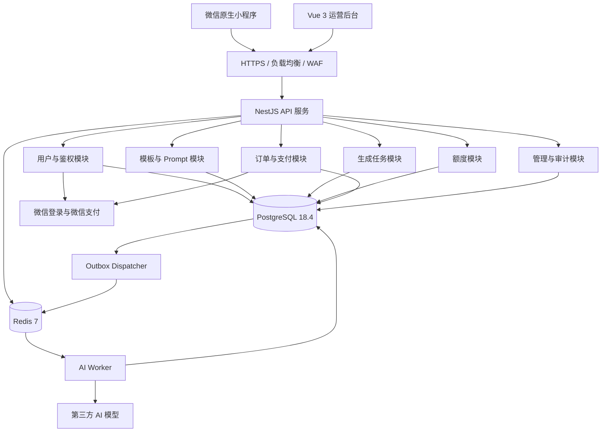
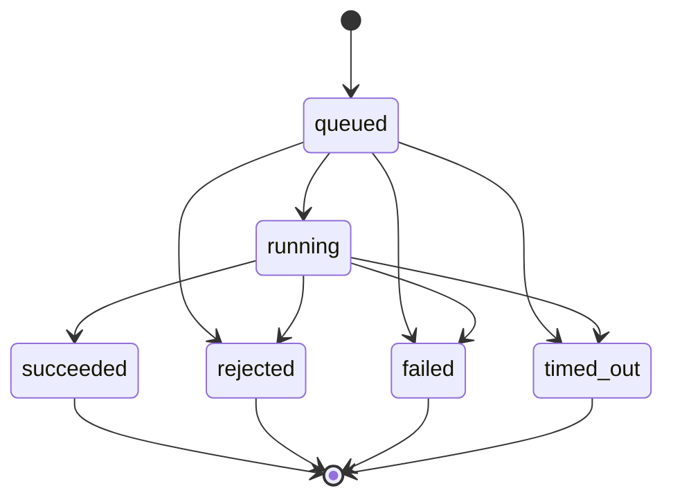
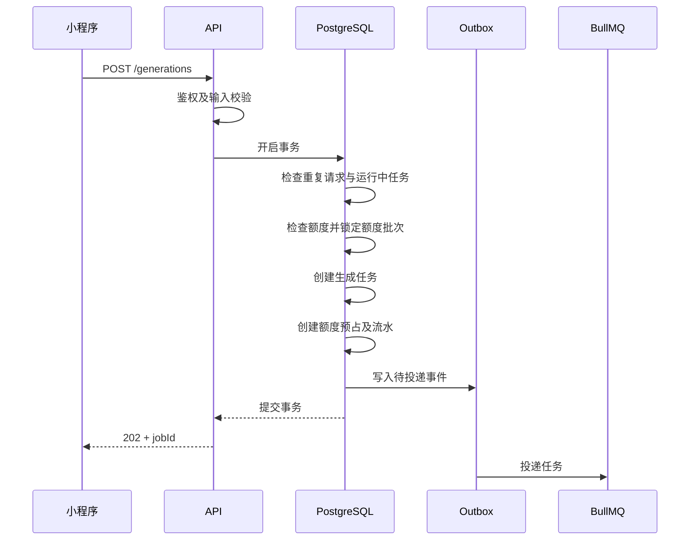
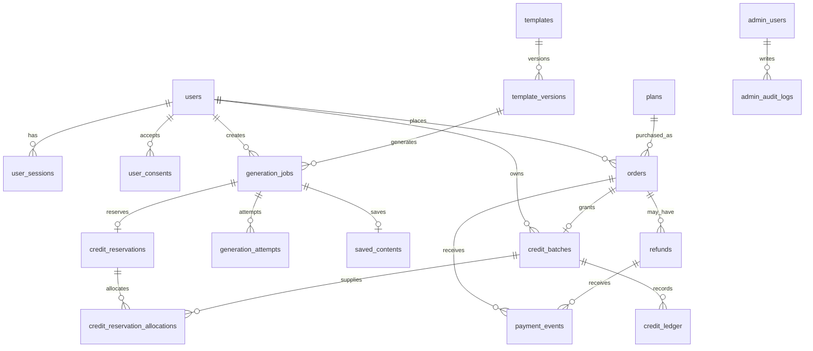
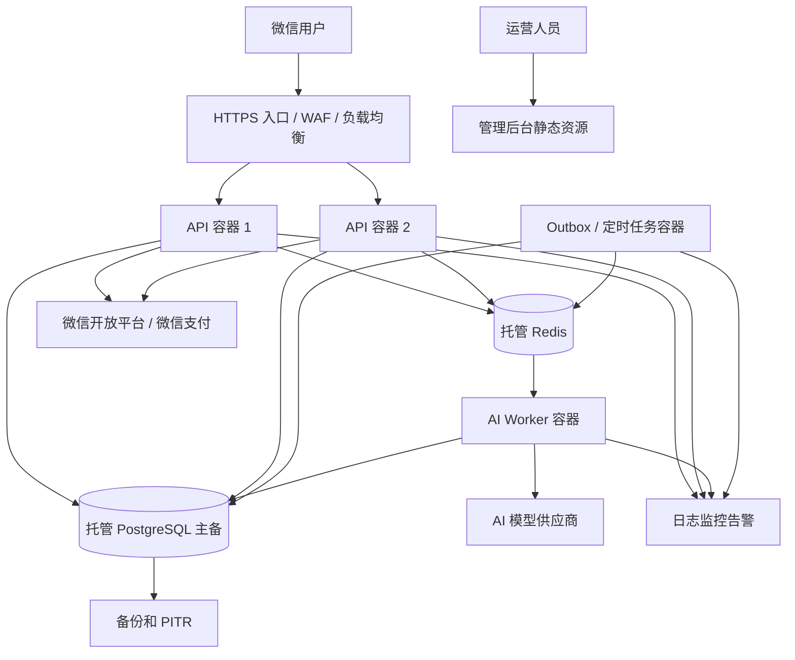

# 文案轻工坊微信小程序
# 03｜系统架构与数据库设计 V1.0

**项目代号：** ai-copywriting-miniapp  
**文档版本：** V1.0  
**编写日期：** 2026-10-20  
**文档状态：** 技术设计完成，待开发前审查与验证  
**适用范围：** 微信小程序、运营后台、服务端、AI Worker、数据库及生产环境  
**关联文档：** 01 项目概述、02 PRD、04 UI/UX、05 AI 模板与 Prompt 设计规范

---

## 1. 文档目的

本文规定文案轻工坊 V1.0 的技术架构、服务模块、数据库结构、核心业务流程、事务边界、并发控制、异步任务可靠性、支付退款一致性、安全措施及生产部署方案。

文档用于指导实际开发和技术审查，不用于替代 PRD 或接口详细契约。

### 1.1 设计目标

1. 满足 V1.0 的 10 个 AI 文案模板和基本用户功能。
2. 支持每日免费额度、付费额度及微信支付。
3. 保证用户不会因为重复请求、任务失败或并发操作被重复扣费。
4. 保证支付通知重复、延迟或丢失时，订单与权益可以恢复一致。
5. 保证 AI Worker 重启、Redis 故障和任务重复投递时，任务状态可以恢复。
6. 保持开发复杂度合理，避免不必要的微服务和基础设施。
7. 保留未来扩展模型、模板、套餐和业务规模的能力。

### 1.2 架构原则

| 原则 | 规定 |
|---|---|
| 简单优先 | 使用模块化单体，不拆分微服务 |
| 数据可信 | PostgreSQL 是业务状态、额度和订单的事实来源 |
| 状态可追溯 | 关键业务变更保留流水或审计记录 |
| 事务优先 | 同一业务操作涉及多个数据库写入时使用事务 |
| 异步解耦 | AI 生成通过消息队列执行 |
| 最终一致性 | 数据库与队列之间采用 Outbox 机制 |
| 幂等处理 | 客户端重试、队列重投、支付回调均不能产生重复业务效果 |
| 最小权限 | 用户端、管理端、Worker 权限分离 |
| 版本固定 | 生成任务绑定创建时的模板及 Prompt 版本 |
| 安全默认 | 模型密钥不下发、敏感日志脱敏、外部输入不可信 |

### 1.3 设计边界

本期只包含：

- 自媒体、职场、学习写作三类用户场景。
- 10 个 P0 模板。
- 微信登录。
- AI 生成、查看、编辑、复制、保存、历史记录。
- 免费与购买额度。
- 微信支付、订单与退款申请。
- 运营管理后台。
- 日志、监控、安全审核及必要的运维能力。

不建设：

- 通用 AI 聊天。
- 多轮 Agent。
- 图文音视频生成。
- 文件上传解析。
- 自动发布。
- 企业组织与协作。
- 订阅制、积分商城、推广分销。
- RAG、向量数据库、微服务或 Kubernetes。

---

## 2. 技术选型

### 2.1 技术栈

| 层次 | 技术 | 说明 |
|---|---|---|
| 小程序 | 微信原生小程序 + TypeScript | 用户端 |
| UI 组件 | TDesign Miniprogram | 统一组件体系 |
| 管理后台 | Vue 3 + TypeScript + Vite | Web 管理端 |
| 后台 UI | Element Plus | 表单、表格、弹窗 |
| 服务端 | Node.js 24 LTS | 统一运行环境 |
| 服务框架 | NestJS 11 + Fastify | REST API |
| 数据库 | PostgreSQL 18.4 | 核心业务数据 |
| ORM | Prisma ORM | 数据访问和迁移 |
| 缓存与队列 | Redis 7 | 限流、缓存、BullMQ |
| 异步任务 | BullMQ | AI 生成任务 |
| 大模型 | 服务端模型适配器 | 支持主模型及备用模型 |
| 支付 | 微信支付 API v3 | 小程序支付 |
| 容器 | Docker | 构建与部署 |
| 基础设施 | 腾讯云托管服务 | 生产环境 |
| 代码仓库 | pnpm workspace | Monorepo |
| API 文档 | OpenAPI | 接口契约 |

**版本约束：** Node.js、NestJS、Prisma、BullMQ 等应在项目初始化时锁定经过兼容性验证的具体版本。本文不假设不同 Prisma 主版本具有相同的事务 API。

### 2.2 不采用微服务的原因

V1.0 的业务边界清楚，主要技术难点是生成任务、额度账务和支付一致性，而不是服务拆分。

采用模块化单体可以：

- 减少网络调用与服务治理成本。
- 在同一个数据库内使用事务。
- 降低开发、测试和部署复杂度。
- 保持模块之间的清晰边界。
- 在必要时独立扩展 AI Worker。

---

## 3. 总体系统架构

### 3.1 逻辑架构



### 3.2 组件职责

**微信小程序**

负责页面、输入校验、任务提交、状态轮询、结果展示、复制、编辑、支付调用。

不直接调用第三方大模型。

**管理后台**

负责模板管理、Prompt 发布、套餐配置、用户与额度管理、订单退款处理、运营指标查看和审计。

**API 服务**

承担身份认证、参数校验、业务规则、数据库事务、额度预占、订单创建、任务创建和管理权限控制。

**PostgreSQL**

保存所有需要可靠持久化和追溯的业务记录。

**Redis**

承担限流计数、短期缓存和 BullMQ 消息队列。

Redis 不是额度、订单和任务最终状态的事实来源。

**AI Worker**

独立运行，负责执行模型调用、内容审核、结果校验、任务终结和额度结算。

**Outbox Dispatcher**

负责把数据库中已提交的待处理事件可靠投递到队列。

**定时对账与恢复程序**

负责检查卡住的生成任务、未处理支付事件、超时预占额度和未完成的异步业务。

---

## 4. 服务模块设计

后端采用一个 NestJS 应用，按照业务领域划分模块。

| 模块 | 职责 |
|---|---|
| `auth` | 微信登录、会话管理、管理员认证 |
| `users` | 用户信息、账户状态、注销 |
| `templates` | 模板查询、模板版本、发布配置 |
| `generations` | 创建任务、任务查询、历史、结果保存 |
| `ai` | Prompt 组装、模型适配、输出校验、内容审核 |
| `credits` | 额度批次、预占、结算、释放、流水 |
| `plans` | 套餐查询及管理 |
| `orders` | 下单、订单查询、订单状态 |
| `payments` | 微信支付、支付回调、支付对账 |
| `refunds` | 退款申请、审核、退款执行与对账 |
| `admin` | 后台 RBAC、操作审计、配置管理 |
| `outbox` | 事务事件记录与队列投递 |
| `jobs` | Worker、重试、超时和任务恢复 |
| `observability` | 指标、日志、告警、链路追踪 |

### 4.1 模块依赖规则

- `generations` 通过 `credits` 的服务接口预占和结算额度。
- `payments` 通过 `orders` 和 `credits` 完成支付权益发放。
- `ai` 不直接修改订单或额度。
- `templates` 负责版本信息，不直接执行模型调用。
- `admin` 调用业务模块提供的管理操作，不绕过业务服务直接修改财务表。
- Worker 可复用相同领域服务，但运行在独立进程中。

### 4.2 代码目录建议

```text
ai-copywriting-miniapp/
├── apps/
│   ├── miniapp/
│   ├── admin-web/
│   ├── api/
│   │   └── src/
│   │       ├── modules/
│   │       ├── common/
│   │       └── main.ts
│   └── ai-worker/
├── packages/
│   ├── contracts/
│   ├── shared-types/
│   ├── validation/
│   └── config/
├── prisma/
│   ├── schema.prisma
│   ├── migrations/
│   └── seed/
├── infra/
│   ├── docker/
│   ├── nginx/
│   └── scripts/
├── docs/
├── pnpm-workspace.yaml
└── package.json
```

`contracts` 存放接口 DTO、枚举及 Schema 定义。

服务端仍是一个模块化单体，不应因为采用 Monorepo 就拆分为多个业务微服务。

---

## 5. 核心业务规则

### 5.1 首发模板

模板编码固定为：

`XHS_TITLE`、`XHS_SCRIPT`、`VIDEO_SPEECH`、`MOMENTS_COPY`、`TEXT_REWRITE`、`WEEKLY_REPORT`、`MEETING_NOTES`、`WORK_EMAIL`、`ESSAY_OUTLINE`、`THESIS_OUTLINE`。

模板的输入字段、输出 Schema 及 Prompt 规则遵循第 05 份文档。

### 5.2 额度规则

当前产品方案：

| 类型 | 数量 | 有效期 |
|---|---|---|
| 每日免费额度 | 5 次 | 北京时间每日重置 |
| 轻量包 | 50 次 | ¥9.9，初始方案不设固定到期日 |
| 进阶包 | 300 次 | ¥19.9，购买后 30 天 |

规则：

1. 一次成功生成消耗 1 次。
2. 一次生成 5 个小红书标题仍消耗 1 次。
3. 编辑、复制和保存不消耗额度。
4. 主动重新生成属于新任务，成功后消耗 1 次。
5. 内部模型重试不额外扣费。
6. 失败、超时和审核拒绝不扣费。
7. 所有可用额度按最早到期时间优先消耗；到期时间相同则先获得的额度优先。
8. 无固定到期时间的额度排在有到期时间的额度之后。
9. 所有额度变更由服务端完成。

### 5.3 风控规则

V1.0 推荐：

- 同一用户最多一个未终结的生成任务。
- 单用户限流：初始建议 10 次请求 / 10 分钟。
- 单用户每日成功生成上限：初始建议 50 次。

限流值、每日成功上限属于可调整运营参数；如实际启用限制，应在购买前明确披露。

### 5.4 业务日定义

- 业务时区：`Asia/Shanghai`。
- 每日免费额度按北京时间自然日计算。
- `quota_day` 在任务创建时固定。
- 任务创建后跨越北京时间午夜，不改变已经预占的额度归属日。
- 数据库存储时间一律使用 `timestamptz`，以 UTC 语义存储并按业务时区展示。

---

## 6. AI 生成任务设计

### 6.1 任务状态机



终态：

- `succeeded`
- `rejected`
- `failed`
- `timed_out`

终态不允许重新转回执行中。

用户点击「重新生成」必须创建新任务，而不是重启旧任务。

### 6.2 创建任务流程



### 6.3 创建任务的数据库事务

同一事务内必须完成：

1. 校验 `clientRequestId` 是否已经使用。
2. 校验同一请求的参数摘要是否一致。
3. 校验模板可用状态及其已发布版本。
4. 校验同一用户没有其他 `queued` 或 `running` 任务。
5. 按业务日创建或读取免费额度批次。
6. 锁定需要消耗的额度批次。
7. 创建 `generation_jobs`。
8. 创建 `credit_reservations`。
9. 创建 `credit_reservation_allocations`。
10. 增加额度批次的 `reserved_qty`。
11. 写入 `credit_ledger`。
12. 写入 `outbox_events`。
13. 提交事务。

**任何一步失败，整个事务回滚。**

不能先写任务、后预占额度，也不能先向 Redis 投递任务、后写 PostgreSQL。

### 6.4 请求幂等

客户端每次主动发起生成时创建一个随机 `clientRequestId`。

数据库设置：

`UNIQUE(user_id, client_request_id)`

规则：

- 相同请求 ID + 相同参数：返回原任务。
- 相同请求 ID + 不同参数：返回幂等冲突。
- 不同请求 ID + 用户仍有未完成任务：返回 `TASK_ALREADY_RUNNING`。
- 网络重试不得创建新的任务或预占新的额度。

请求参数应使用规范化序列化后计算摘要并保存为 `request_hash`。

### 6.5 Worker 执行流程

1. 从 BullMQ 获取任务 ID。
2. 查询 PostgreSQL 中的真实任务状态。
3. 原子地声明任务执行权。
4. 固定本次执行的 `processing_token` 与租约。
5. 检查任务截止时间。
6. 读取已绑定的 Prompt 版本。
7. 进行输入内容安全检查。
8. 调用主模型，按策略允许切换备用模型。
9. 解析输出并验证 JSON Schema。
10. 进行输出内容安全检查。
11. 开启数据库事务，确认执行令牌仍有效。
12. 写入结果，将任务修改为 `succeeded`。
13. 把预占额度转换为已消耗额度。
14. 写入生成尝试及额度流水。
15. 提交事务。

模型调用、网络请求和内容审核不得放在长时间持有数据库锁的事务中。

### 6.6 Worker 执行权

为防止 Worker 崩溃恢复后并行写入，任务记录包含：

- `processing_token`
- `lease_until`
- `attempt_count`
- `deadline_at`

Worker 取得执行权时，原子更新这些字段。

在写入结果之前，必须确认当前 `processing_token` 与数据库一致。

如果旧 Worker 在租约失效后返回结果，而新 Worker 已重新获得执行权，旧 Worker 的写入必须被拒绝。

这种方式可以保证**用户账务只结算一次**，但不保证极端故障下外部模型只被调用一次。

### 6.7 超时与重试

初始参数：

- 任务总截止时间：60 秒。
- 临时故障允许最多一次内部重试。
- 重试必须受到任务总截止时间限制。
- 仅对网络错误、限流和可恢复的供应商错误重试。
- 审核拒绝不重试。
- 已成功结算的任务不允许再执行。

建议为每次模型请求设置小于任务总截止时间的独立超时，避免单次调用耗尽所有恢复时间。

### 6.8 状态恢复

定时任务检查：

- 长时间停留在 `queued` 且没有有效队列任务的记录。
- `running` 但租约已经过期的记录。
- 已超过 `deadline_at` 的任务。
- 已终结但额度预占未结算的异常记录。

恢复动作：

- 可恢复任务：重新投递。
- 超出尝试次数或截止时间：转终态并释放额度。
- 已成功任务：不得重复扣费。
- 状态不一致：记录异常并告警。

---

## 7. 额度账务设计

### 7.1 数据模型

额度采用：

**额度批次 + 预占记录 + 预占分配 + 不可变流水**

四层结构。

| 表 | 作用 |
|---|---|
| `credit_batches` | 记录每一批额度及有效期 |
| `credit_reservations` | 记录生成任务预占 |
| `credit_reservation_allocations` | 记录预占来自哪个额度批次 |
| `credit_ledger` | 记录所有额度变动 |

### 7.2 额度批次字段

每个批次保存：

- `granted_qty`：总发放额度。
- `reserved_qty`：已预占、尚未结算。
- `consumed_qty`：已成功消耗。
- `held_qty`：因退款流程暂时冻结。
- `revoked_qty`：已撤销。
- `expired_qty`：已到期且失效的未使用额度。

可用余额由数据库计算：

```text
available =
    granted_qty
  - reserved_qty
  - consumed_qty
  - held_qty
  - revoked_qty
  - expired_qty
```

并必须满足：

```text
所有数量 >= 0
reserved + consumed + held + revoked + expired <= granted
```

查询可用额度时，还必须检查额度批次的生效与到期时间。

### 7.3 预占规则

采用数据库行级锁，按以下顺序选择批次：

1. 在所有已生效、未到期的可用批次中，按到期时间升序选择；免费额度和付费额度使用同一规则。
2. 无固定到期时间的批次排在有到期时间的批次之后。
3. 到期时间相同时，按获得时间升序选择；仍相同时按批次 ID 排序，保证结果稳定。

当需要预占 1 次时：

- 锁定目标批次。
- 确保可用额度大于或等于 1。
- `reserved_qty += 1`。
- 创建预占记录。
- 写入 `reserve` 类型流水。

此操作只能在事务内完成。

### 7.4 成功结算

任务成功时，同一事务中：

- `reserved_qty -= 1`
- `consumed_qty += 1`
- 预占状态改为 `consumed`
- 写入 `consume` 流水
- 任务状态改为 `succeeded`
- 更新业务日成功次数

只有事务成功提交，任务才视为完成结算。

### 7.5 失败释放

任务失败、拒绝或超时时：

- `reserved_qty -= 1`
- 预占状态改为 `released`
- 写入 `release` 流水
- 更新任务终态

如果额度批次仍有效，被释放的额度恢复为可用。

如果额度批次已经到期，则将释放的数量转入 `expired_qty`，避免过期额度重新变成可用。

### 7.6 额度过期处理

由定时任务处理：

- 只对已到期批次的**未预占、未冻结可用额度**进行过期处理。
- 增加 `expired_qty`。
- 写入唯一的 `expire` 流水。
- 不直接改变已预占额度。

任务在额度有效期间完成预占后，即使执行跨越到期时刻，仍可以使用该次有效预占完成结算。

### 7.7 免费额度防重复发放

每日免费额度作为独立批次。

批次唯一来源建议：

```text
source_type = daily_free
source_ref = YYYY-MM-DD
```

唯一约束：

`UNIQUE(user_id, source_type, source_ref)`

这样在 API 多实例并发处理时，同一个用户、同一个业务日只会创建一批免费额度。

### 7.8 流水要求

每一笔额度变更都记录：

- 用户。
- 额度批次。
- 关联任务、订单或退款。
- 业务事件类型。
- 各计数字段变动量。
- 发生时间。
- 全局唯一业务事件键。

额度流水不可随意修改或删除。

人工调整额度也必须产生明确原因和管理员审计记录，不允许直接在数据库中修改余额而不记账。

---

## 8. 微信支付与订单设计

### 8.1 订单状态机

订单基础状态：

```text
created → paying → paid
      ↘ closed
```

已支付订单不允许直接变成未支付。

退款状态在 `refunds` 中独立保存。

为了兼容 PRD 的用户端显示，可组合订单与退款状态得到：

- 待支付
- 支付处理中
- 已支付
- 已关闭
- 退款处理中
- 已退款
- 退款处理异常

不建议用一个字段同时承载支付状态与全部退款过程。

### 8.2 创建订单

API 接收套餐 ID 和 `clientRequestId`。

服务端：

1. 校验用户登录状态。
2. 查询有效套餐。
3. 校验价格、额度、有效期。
4. 创建订单。
5. 保存套餐购买快照。
6. 生成唯一商户订单号。
7. 调用微信支付下单接口。
8. 返回小程序拉起支付所需参数。

金额一律使用整数分：

- ¥9.9 = `990`
- ¥19.9 = `1990`

不得使用浮点数存储金额。

### 8.3 套餐快照

订单创建时保存：

- 套餐名称。
- 价格。
- 额度数量。
- 有效期规则。

管理员以后修改套餐，不影响已经创建的订单。

### 8.4 支付通知处理

微信支付回调处理必须：

1. 使用原始请求体校验签名。
2. 使用正确的平台证书或公钥验证来源。
3. 解密通知中的资源。
4. 校验应用 ID、商户号、订单号、金额和交易状态。
5. 对通知事件 ID 去重。
6. 将已验证事件持久化到 `payment_events`。
7. 同一数据库事务内写入后续处理事件。
8. 提交事务成功后返回接收成功。
9. 异步完成订单状态更新和额度发放。

**只有经过持久化的有效通知，才能返回成功确认。**

即使微信支付通知重复到达，事件唯一约束和订单状态条件也必须防止重复发放额度。

### 8.5 支付权益发放

支付处理程序：

1. 锁定订单。
2. 检查该订单是否已经发放额度。
3. 将已验证支付结果与订单金额、身份信息核对。
4. 更新订单状态和支付时间。
5. 按订单快照创建额度批次。
6. 写入 `grant` 类型流水。
7. 标记支付事件处理完成。
8. 提交事务。

购买额度批次设置：

`UNIQUE(order_id)`，其中 `order_id` 非空。

即使支付通知重复或 Worker 重试，同一订单也最多发放一批购买额度。

### 8.6 支付结果不确定

不以客户端 `wx.requestPayment` 的回调作为订单最终支付依据。

客户端支付结束后：

- 查询服务端订单状态。
- `paid` 且权益发放完成：展示支付成功。
- 尚未确认：展示支付结果核实中。
- 取消支付：返回订单或套餐页。
- 对长时间未确认订单发起微信支付主动查询与对账。

订单关闭与支付确认发生竞态时，以经过验证的微信支付交易事实为准，由对账程序处理，不直接丢弃真实成功支付。

---

## 9. 退款设计

### 9.1 退款状态

退款记录独立保存：

```text
requested
   ├── rejected
   └── approved
         ↓
      processing
       ├── succeeded
       └── failed
```

### 9.2 退款边界

退款资格、使用后的退款金额计算方式和实际可退条件，属于尚需确认的商业及合规规则。

V1.0 不应在没有明确规则时自动执行按比例退款。

**初始建议：**

- 未使用且符合退款规则的套餐，可进入正常审核流程。
- 已部分使用的套餐，转人工审核，不直接计算和发起退款。
- 所有退款操作必须有订单、退款记录和必要审计信息。

### 9.3 退款额度冻结

退款获批且进入支付侧执行前：

1. 锁定订单与对应额度批次。
2. 校验需要退回的额度仍符合退款条件。
3. 将对应可用额度转入 `held_qty`。
4. 写入 `refund_hold` 流水。
5. 创建退款执行事件。
6. 提交事务。

冻结后，用户不能同时使用这些待退额度。

### 9.4 退款成功

根据经过验证的微信退款结果：

- `held_qty -= 对应数量`
- `revoked_qty += 对应数量`
- 写入 `refund_confirm` 流水
- 退款状态改为 `succeeded`

退款事件及额度撤销必须保证幂等。

### 9.5 退款失败

经支付侧确认退款失败后：

- 释放对应冻结额度。
- 若额度已到期，将其转为过期额度。
- 写入 `refund_release` 流水。
- 退款状态改为 `failed`。
- 允许按业务流程人工处理或再次发起新的合法退款请求。

### 9.6 退款对账

退款请求发出后必须保存支付侧退款编号。

定时检查长时间处于 `processing` 的记录，并通过支付侧查询确定最终结果。

不得仅依据请求接口返回成功，就认定用户资金已经退回。

---

## 10. BullMQ 与 Outbox 可靠性设计

### 10.1 队列划分

推荐逻辑队列：

| 队列 | 作用 |
|---|---|
| `ai-generation` | AI 文案生成 |
| `payment-events` | 处理有效支付事件 |
| `refund-events` | 发起与处理退款 |
| `maintenance` | 对账、过期额度处理、必要恢复任务 |

不同职责可以使用相同 Redis 实例，但应合理配置队列前缀、并发和连接池。

### 10.2 消息内容

BullMQ 任务只传最小必要信息：

```json
{
  "jobId": "业务任务UUID",
  "eventId": "事务事件UUID"
}
```

不在 Redis 任务负载中复制完整用户输入、模型密钥、订单敏感数据或 Prompt 正文。

### 10.3 Outbox 机制

创建业务任务时，在 PostgreSQL 事务中同时写入 `outbox_events`。

Dispatcher：

1. 查询待发送事件。
2. 使用 `FOR UPDATE SKIP LOCKED` 获取处理权。
3. 向 BullMQ 投递事件。
4. 投递成功后标记已发布。
5. 失败则记录原因、次数并等待重试。

如果投递成功后进程崩溃，数据库尚未标记已发布，事件可能再次投递。

因此：

**Outbox 保证不轻易丢事件；真正的业务幂等由 PostgreSQL 状态和唯一约束保证。**

### 10.4 BullMQ Job ID

建议使用业务事件 ID 或业务任务 ID 作为稳定 `jobId`。

这可以减少排队阶段的重复任务，但不能替代数据库幂等。

当已完成 Job 被清理后，相同 Job ID 仍可能被再次加入；Worker 必须检查真实业务状态。

### 10.5 重试配置

生成任务：

- 最多两次执行尝试，包括首次。
- 采用适度退避。
- 超过业务截止时间立即终结。
- 不允许重试导致第二次扣费。

支付事件：

- 可以重复执行，但每次都要检查事件处理状态。
- 处理失败后持续对账或进入人工告警。
- 不允许自动抹掉原始有效支付事实。

### 10.6 Redis 故障

Redis 不可用时：

- 已写入 PostgreSQL 的任务不会因为队列不可用而消失。
- Outbox 保留待投递事件。
- 生成任务可能延迟。
- 恢复后重新投递并由 Worker 检查状态。
- 对长时间无法处理的生成任务执行超时释放。

如果故障持续，应通过健康检查暂停新生成请求，避免无限积压任务及额度预占。

支付回调的有效事件持久化不应依赖 Redis 可用性。

---

## 11. 数据库设计

### 11.1 数据库约定

- 数据库：PostgreSQL 18.4。
- 主键：`uuid`。
- 时间：`timestamptz`。
- 金额：`bigint`，单位为分。
- 次数：`integer`。
- 模板配置与结构化结果：`jsonb`。
- 状态：`varchar` + `CHECK` 约束。
- 布尔：`boolean`。
- 业务日：`date`。
- 用户生成原文：不得写入常规应用日志。

### 11.2 命名约定

- 表名采用复数蛇形命名。
- 字段名采用 `snake_case`。
- 主键统一为 `id`，部分复合主键表除外。
- 外键统一使用 `xxx_id`。
- 创建时间使用 `created_at`。
- 修改时间使用 `updated_at`。
- 归档、删除和注销不等同于物理删除。

### 11.3 ER 关系图



注：此图展示核心业务关系，`outbox_events`、`user_daily_usage` 等辅助表的关系见后续字段定义。

### 11.4 数据表总览

V1.0 共设计 20 张表。

| 编号 | 表名 | 用途 |
|---|---|---|
| 01 | `users` | 微信用户 |
| 02 | `user_sessions` | 登录会话 |
| 03 | `user_consents` | 协议及隐私同意记录 |
| 04 | `admin_users` | 管理员 |
| 05 | `templates` | AI 模板 |
| 06 | `template_versions` | 模板与 Prompt 版本 |
| 07 | `plans` | 购买套餐 |
| 08 | `orders` | 支付订单 |
| 09 | `refunds` | 退款记录 |
| 10 | `payment_events` | 支付与退款通知事件 |
| 11 | `generation_jobs` | AI 生成任务 |
| 12 | `generation_attempts` | 模型调用尝试 |
| 13 | `saved_contents` | 用户保存或编辑内容 |
| 14 | `credit_batches` | 额度批次 |
| 15 | `credit_reservations` | 额度预占 |
| 16 | `credit_reservation_allocations` | 预占批次分配 |
| 17 | `credit_ledger` | 额度流水 |
| 18 | `user_daily_usage` | 每日成功使用量 |
| 19 | `outbox_events` | 事务事件 |
| 20 | `admin_audit_logs` | 后台操作审计 |

### 11.5 各表字段设计

以下为逻辑字段定义。工程模型以 [`prisma/schema.prisma`](../prisma/schema.prisma) 为准；需在锁定 Prisma 版本后生成并验证迁移，补齐 Prisma Schema 无法表达的 PostgreSQL `CHECK`、部分唯一索引等约束。当前不能将逻辑表格视为已验证的建表结果。

#### 01｜users

| 字段 | 类型 | 说明 |
|---|---|---|
| `id` | uuid | 主键 |
| `wechat_openid` | varchar(128) | 微信用户标识，唯一 |
| `status` | varchar(16) | active、disabled、deleting、deleted |
| `deleted_at` | timestamptz | 账户删除时间 |
| `created_at` | timestamptz | 创建时间 |
| `updated_at` | timestamptz | 修改时间 |

不默认收集手机号、真实姓名及用户头像。

#### 02｜user_sessions

| 字段 | 类型 | 说明 |
|---|---|---|
| `id` | uuid | 主键 |
| `user_id` | uuid | FK → users |
| `token_hash` | char(64) | 会话令牌摘要，唯一 |
| `expires_at` | timestamptz | 过期时间 |
| `revoked_at` | timestamptz | 撤销时间 |
| `created_at` | timestamptz | 创建时间 |

客户端使用随机会话令牌，数据库仅保存摘要。Redis 可以缓存会话校验结果，但数据库保留撤销能力。

#### 03｜user_consents

字段：

`id uuid PK`、`user_id uuid FK`、`document_type varchar(32)`、`document_version varchar(32)`、`accepted_at timestamptz`、`source varchar(32)`。

唯一约束：

`(user_id, document_type, document_version)`

用于保留必要的协议同意版本记录。

#### 04｜admin_users

字段：

`id uuid PK`、`username varchar(80)`、`password_hash text`、`mfa_secret_ciphertext text`、`role varchar(24)`、`status varchar(16)`、`last_login_at timestamptz`、`created_at`、`updated_at`。

建议角色：

- `super_admin`
- `operator`
- `finance`

管理员必须使用可靠密码哈希算法，并启用多因素认证。

#### 05｜templates

字段：

`id uuid PK`、`code varchar(40)`、`name varchar(80)`、`category varchar(32)`、`description varchar(500)`、`status varchar(16)`、`sort_order integer`、`current_version_id uuid`、`updated_by uuid NULL`、`created_at`、`updated_at`。

关键约束：

- `code` 唯一。
- `updated_by` 关联最近修改该模板的管理员；历史记录未知时保持 `NULL`。
- 当前版本必须属于同一个模板。
- 不允许发布版本不存在的模板配置。
- 模板下架只阻止新任务，不影响已经创建的历史任务。

#### 06｜template_versions

字段：

`id uuid PK`、`template_id uuid FK`、`version integer`、`status varchar(16)`、`form_schema jsonb`、`output_schema jsonb`、`system_prompt_version varchar(40)`、`developer_prompt text`、`model_config jsonb`、`change_log text`、`published_by uuid`、`published_at`、`created_at`。

唯一约束：

`(template_id, version)`

版本发布后不得覆盖其历史内容。

创建中的任务引用固定版本，避免 Prompt 更新改变正在处理的业务结果。

#### 07｜plans

字段：

`id uuid PK`、`code varchar(40)`、`name varchar(80)`、`price_fen bigint`、`credits integer`、`valid_days integer NULL`、`status varchar(16)`、`sort_order integer`、`created_at`、`updated_at`。

`valid_days = NULL` 表示该套餐不设置固定有效天数，并不表示永久不可撤销。

套餐修改不允许覆盖既有订单快照。

#### 08｜orders

字段：

`id uuid PK`、`user_id uuid FK`、`plan_id uuid FK`、`client_request_id varchar(80)`、`request_hash char(64)`、`merchant_order_no varchar(64)`、`plan_name_snapshot varchar(80)`、`price_fen bigint`、`credits_snapshot integer`、`valid_days_snapshot integer NULL`、`status varchar(16)`、`wechat_transaction_id varchar(64)`、`paid_at`、`closed_at`、`created_at`、`updated_at`。

唯一约束：

- `merchant_order_no`
- `(user_id, client_request_id)`
- `wechat_transaction_id` 非空时唯一

#### 09｜refunds

字段：

`id uuid PK`、`order_id uuid FK`、`user_id uuid FK`、`client_request_id varchar(80)`、`merchant_refund_no varchar(64)`、`wechat_refund_id varchar(64)`、`amount_fen bigint`、`status varchar(16)`、`reason varchar(500)`、`review_note varchar(500)`、`reviewed_by uuid`、`reviewed_at`、`finished_at`、`created_at`、`updated_at`。

关键约束：

- 商户退款单号唯一。
- 同一个订单不允许同时存在多个未结束的退款流程。
- 重复退款请求不能创建重复的退款业务。

#### 10｜payment_events

字段：

`id uuid PK`、`provider varchar(16)`、`provider_event_id varchar(80)`、`event_type varchar(32)`、`order_id uuid NULL`、`refund_id uuid NULL`、`transaction_ref varchar(80)`、`payload_sha256 char(64)`、`verified_payload jsonb`、`processing_status varchar(16)`、`received_at`、`processed_at`、`last_error varchar(500)`。

唯一约束：

`(provider, provider_event_id)`

只存储已验签、已解密并经过必要检查的最小事件信息，不默认保存完整支付原始报文。

#### 11｜generation_jobs

字段：

`id uuid PK`、`user_id uuid FK`、`template_id uuid FK`、`template_version_id uuid FK`、`client_request_id varchar(80)`、`request_hash char(64)`、`input_data jsonb`、`result_data jsonb NULL`、`schema_version varchar(32)`、`status varchar(16)`、`quota_day date`、`processing_token uuid NULL`、`lease_until timestamptz NULL`、`attempt_count integer`、`deadline_at`、`preview_text varchar(240)`、`error_code varchar(64)`、`deleted_at`、`content_purged_at`、`started_at`、`completed_at`、`created_at`、`updated_at`。

关键约束：

- `(user_id, client_request_id)` 唯一。
- `template_version_id` 必须属于对应模板。
- 同一用户最多一个状态为 `queued` 或 `running` 的任务。
- 任务成功时必须有结果或合法的历史内容清理记录。

`result_data` 保存服务端校验后的模板结构化结果及对应的可复制文本；`schema_version` 记录该结构所使用的输出 Schema 版本。结果展示以任务创建时固定的模板版本解释数据，不使用当前最新版本重新解析旧任务。

#### 12｜generation_attempts

字段：

`id uuid PK`、`job_id uuid FK`、`attempt_no integer`、`provider varchar(40)`、`model_name varchar(80)`、`provider_request_id varchar(160)`、`status varchar(16)`、`input_tokens integer`、`output_tokens integer`、`duration_ms integer`、`error_code varchar(64)`、`started_at`、`completed_at`。

唯一约束：

`(job_id, attempt_no)`

用来记录一次用户任务下可能发生的内部模型调用尝试。

#### 13｜saved_contents

字段：

`id uuid PK`、`user_id uuid FK`、`generation_job_id uuid FK`、`edited_result jsonb NULL`、`edited_text text NULL`、`created_at`、`updated_at`。

约束：

- 每个生成任务最多关联一条当前已保存内容。
- `generation_job_id` 唯一。
- `edited_result` 与 `edited_text` 至少有一个不为空。

用户编辑后的内容与原始 AI 结果分开存储。

#### 14｜credit_batches

字段：

`id uuid PK`、`user_id uuid FK`、`order_id uuid NULL`、`source_type varchar(24)`、`source_ref varchar(120)`、`granted_qty integer`、`reserved_qty integer`、`consumed_qty integer`、`held_qty integer`、`revoked_qty integer`、`expired_qty integer`、`effective_at`、`expires_at NULL`、`created_at`、`updated_at`。

关键约束：

- `(user_id, source_type, source_ref)` 唯一。
- `order_id` 非空时唯一。
- 数量非负。
- 额度组成数量总和不得超过发放总数。

#### 15｜credit_reservations

字段：

`id uuid PK`、`user_id uuid FK`、`generation_job_id uuid FK`、`quantity integer`、`status varchar(16)`、`reserved_at`、`settled_at`。

约束：

- `generation_job_id` 唯一。
- V1.0 的 `quantity` 固定为 1。
- 状态仅能由 `reserved` 转入 `consumed` 或 `released`。

#### 16｜credit_reservation_allocations

字段：

`id uuid PK`、`reservation_id uuid FK`、`batch_id uuid FK`、`quantity integer`。

唯一约束：

`(reservation_id, batch_id)`

用于明确本次预占从哪个额度批次获得。

必须校验额度批次和预占归属同一个用户。

#### 17｜credit_ledger

字段：

`id uuid PK`、`user_id uuid FK`、`batch_id uuid FK`、`reservation_id uuid NULL`、`order_id uuid NULL`、`refund_id uuid NULL`、`event_key varchar(180)`、`event_type varchar(24)`、`delta_granted integer`、`delta_reserved integer`、`delta_consumed integer`、`delta_held integer`、`delta_revoked integer`、`delta_expired integer`、`reason varchar(500)`、`created_at`。

唯一约束：

`event_key`

流水为追加式记录，用于核对每一个额度批次的状态变化。

#### 18｜user_daily_usage

字段：

`user_id uuid FK`、`biz_date date`、`success_count integer`、`updated_at`。

复合主键：

`(user_id, biz_date)`

成功次数必须在生成任务成功结算事务中原子增加。

#### 19｜outbox_events

字段：

`id uuid PK`、`event_key varchar(180)`、`event_type varchar(80)`、`aggregate_id uuid`、`payload jsonb`、`status varchar(16)`、`available_at`、`attempts integer`、`published_at`、`last_error varchar(500)`、`created_at`。

关键约束：

`event_key` 唯一。

支持多 Dispatcher 并发投递和失败恢复。

#### 20｜admin_audit_logs

字段：

`id uuid PK`、`admin_user_id uuid FK`、`action varchar(100)`、`resource_type varchar(80)`、`resource_id varchar(120)`、`request_id varchar(100)`、`ip_hash char(64)`、`change_summary jsonb`、`created_at`。

必须记录：

- Prompt 发布、回滚与下架。
- 套餐配置变化。
- 人工额度调整。
- 退款审核与操作。
- 管理员权限变更。

日志中不得保存管理员密码、密钥或完整敏感用户数据。

---

## 12. 索引与完整性约束

### 12.1 必要唯一索引

| 表 | 唯一约束 | 目的 |
|---|---|---|
| users | `wechat_openid` | 防止重复微信用户 |
| templates | `code` | 模板编码唯一 |
| template_versions | `(template_id, version)` | 版本不可冲突 |
| generation_jobs | `(user_id, client_request_id)` | 提交幂等 |
| orders | `(user_id, client_request_id)` | 创建订单幂等 |
| orders | `merchant_order_no` | 商户订单唯一 |
| payment_events | `(provider, provider_event_id)` | 回调去重 |
| credit_batches | `(user_id, source_type, source_ref)` | 发额度幂等 |
| credit_batches | `order_id` 非空唯一 | 一笔订单只发一次 |
| credit_reservations | `generation_job_id` | 任务只预占一次 |
| credit_ledger | `event_key` | 额度事件只记一次 |
| outbox_events | `event_key` | 事务事件只产生一次 |

### 12.2 生成任务并发限制

使用 PostgreSQL 部分唯一索引：

```sql
CREATE UNIQUE INDEX uq_generation_active_user
ON generation_jobs(user_id)
WHERE status IN ('queued', 'running');
```

该约束由数据库强制执行，不依赖单个 API 实例中的内存锁。

### 12.3 关键查询索引

建议：

```text
generation_jobs:
(user_id, created_at DESC, id DESC)

orders:
(user_id, created_at DESC, id DESC)

credit_batches:
(user_id, expires_at, created_at)

credit_ledger:
(user_id, created_at DESC, id DESC)

outbox_events:
(status, available_at, created_at)

payment_events:
(processing_status, received_at)
```

### 12.4 跨表业务约束

数据库普通外键无法覆盖全部业务不变量。

服务层事务还必须校验：

- 订单、退款和额度批次归属相同用户。
- 额度预占对应的任务归属相同用户。
- 当前 Prompt 版本与任务指定模板一致。
- 退款金额不超过实际允许金额。
- 已终结预占不能再次结算。
- 已发放的订单不能再次发放。
- 用户只能访问自己的任务和历史。

---

## 13. 数据库事务与并发控制

### 13.1 通用要求

- 数据库事务保持短小。
- 事务中不得调用大模型或微信支付等外部接口。
- 锁定顺序保持稳定，降低死锁概率。
- 关键操作优先使用数据库唯一约束与条件更新。
- 遇到死锁或可序列化事务冲突，可以有限重试**整个数据库事务**。
- 重试必须保证 `clientRequestId`、事件键等业务标识不改变。

### 13.2 额度预占的条件更新

示意 SQL：

```sql
UPDATE credit_batches
SET reserved_qty = reserved_qty + 1,
    updated_at = now()
WHERE id = $1
  AND effective_at <= now()
  AND (expires_at IS NULL OR expires_at > now())
  AND granted_qty
      - reserved_qty
      - consumed_qty
      - held_qty
      - revoked_qty
      - expired_qty >= 1
RETURNING id;
```

返回零行表示当前批次不可预占。

调用方必须继续检查其他可用批次或返回额度不足。

此 SQL 是事务中的局部操作，不能代替完整的预占记录与流水写入。

### 13.3 额度结算原则

终态更新和额度结算必须在同一事务内完成。

示例：

```text
BEGIN

锁定生成任务
检查 status = running
检查 processing_token 匹配

锁定额度预占
检查 status = reserved

更新任务结果和状态
更新额度批次
更新预占状态
写入额度流水
增加当日成功次数

COMMIT
```

### 13.4 用户成功次数上限

如果启用每日成功生成上限：

- 创建任务时先检查业务日当前成功次数。
- 同一用户只允许一个未完成生成任务。
- 成功结算时再次校验上限并原子增加计数。
- 达到上限后拒绝新任务。

上限规则必须与产品页面披露保持一致。

### 13.5 事务隔离级别

默认可在 PostgreSQL `READ COMMITTED` 下结合行级锁、唯一索引和条件更新实现主要业务逻辑。

对于较复杂的退款额度冻结等事务，可以评估使用更强的隔离级别。

不能简单认为提高隔离级别即可代替幂等设计。

具体 Prisma 事务写法以项目最终固定的 Prisma 版本为准，并通过真实并发测试验证。

---

## 14. API 架构与接口边界

### 14.1 REST 接口

用户端基础前缀：

`/api/v1`

| 方法 | 路径 | 功能 |
|---|---|---|
| POST | `/auth/wechat-login` | 微信登录 |
| GET | `/me` | 当前用户 |
| GET | `/templates` | 模板列表 |
| GET | `/templates/:id` | 模板详情 |
| POST | `/generations` | 创建生成任务 |
| GET | `/generations/:id` | 任务及结果 |
| GET | `/generations` | 历史记录 |
| DELETE | `/generations/:id` | 删除记录 |
| PUT | `/generations/:id/saved-content` | 保存编辑 |
| GET | `/credits` | 查询额度 |
| GET | `/plans` | 套餐列表 |
| POST | `/orders` | 创建订单 |
| POST | `/orders/:id/pay` | 发起支付 |
| GET | `/orders` | 订单列表 |
| GET | `/orders/:id` | 订单详情 |
| POST | `/refund-requests` | 退款申请 |
| DELETE | `/me` | 注销账户 |

运营接口单独使用 `/api/admin/v1` 命名空间。

已明确的模板字段、生成接口、成功/错误封装及路由登记在 [`packages/contracts/src`](../packages/contracts/src)；其他接口的 DTO 与分页结构需在对应业务规则确定后继续补齐，并保持该共享契约与 PRD 一致。

### 14.2 生成任务响应

创建任务成功时建议返回 HTTP `202 Accepted`。

```json
{
  "code": "OK",
  "message": "任务已提交",
  "data": {
    "jobId": "uuid",
    "status": "queued",
    "estimatedCreditCost": 1
  },
  "requestId": "request-id"
}
```

任务成功查询时，`data.result` 同时包含可复制的 `text`、经模板 Schema 校验的 `structured`、`schemaVersion` 和 `aiGenerated`。前端使用 `structured` 呈现模板专属结构，使用 `text` 做整段复制与保存；不得通过拆分 `text` 还原结构。

### 14.3 错误结构

```json
{
  "code": "INSUFFICIENT_CREDITS",
  "message": "当前可用额度不足",
  "details": null,
  "requestId": "request-id"
}
```

业务错误统一使用稳定错误码，不将数据库异常、第三方密钥和内部堆栈返回给客户端。

### 14.4 关键错误码

| 错误码 | 触发场景 |
|---|---|
| `AUTH_REQUIRED` | 未登录 |
| `SESSION_EXPIRED` | 会话过期 |
| `VALIDATION_ERROR` | 参数校验失败 |
| `TEMPLATE_UNAVAILABLE` | 模板不可用 |
| `INSUFFICIENT_CREDITS` | 额度不足 |
| `TASK_ALREADY_RUNNING` | 已有执行中任务 |
| `IDEMPOTENCY_CONFLICT` | 幂等键被用于不同请求 |
| `RATE_LIMITED` | 请求过于频繁 |
| `CONTENT_REJECTED` | 内容审核拒绝 |
| `AI_TIMEOUT` | AI 生成超时 |
| `AI_SERVICE_ERROR` | 模型服务异常 |
| `ORDER_NOT_PAYABLE` | 订单不可支付 |
| `PAYMENT_PENDING` | 支付待确认 |
| `PERMISSION_DENIED` | 无权限 |
| `SERVICE_UNAVAILABLE` | 服务暂不可用 |

---

## 15. 安全设计

### 15.1 微信用户认证

采用微信 `wx.login` 获取临时登录凭证，由服务端与微信服务端完成凭证交换。

服务端建立本应用会话。

原则：

- 不信任客户端传入的 openid。
- 不在客户端存储微信 AppSecret。
- 不以客户端提供的用户 ID 判断数据归属。
- 账户注销时撤销全部有效会话。

### 15.2 管理员安全

- 独立后台认证。
- 密码哈希存储。
- 多因素认证。
- 角色权限控制。
- 高风险操作记录审计。
- 重要配置变更要求再次确认。
- 不允许普通管理员读取完整支付密钥和模型密钥。

### 15.3 密钥管理

包括：

- 微信 AppSecret。
- 微信支付 API v3 密钥。
- 微信支付商户私钥。
- 模型 API Key。
- 数据库连接凭据。
- 会话签名或加密密钥。

要求：

- 不写入 Git。
- 不硬编码在前端。
- 通过安全密钥配置或环境注入。
- 限制读取权限。
- 支持轮换。
- 日志禁止输出密钥。

### 15.4 用户数据保护

- 数据传输使用 HTTPS。
- 数据库启用托管加密和备份保护。
- 用户生成内容只在授权业务中使用。
- 管理后台默认不显示完整生成原文。
- 输入、输出和日志按最小化原则处理。
- 数据查询必须具有用户归属校验。
- 对管理员及服务账号实施最小权限。

### 15.5 AI 内容安全

执行：

输入审核 → Prompt 组装 → 模型生成 → JSON Schema 校验 → 输出审核。

不使用备用模型绕过内容审核。

模型输出只能作为内容数据，不能执行数据库操作、改变额度、决定支付或修改权限。

### 15.6 AI 生成内容标识

产品需要具备 AI 生成内容提示与相关标识能力。

小程序结果页、复制内容、生成内容记录与对外使用说明，应依据实际适用的 AI 生成合成内容标识要求实施。

具体显式标识、隐式标识及复制行为的处理方式，应在正式上线前结合适用法规和平台要求确认。

---

## 16. 数据生命周期

### 16.1 初始保留建议

| 数据 | 初始处理建议 |
|---|---|
| 未保存的生成正文 | 暂定 90 天 |
| 已保存内容 | 保留至用户删除或账号处理 |
| 失败任务的非必要信息 | 暂定 7 天 |
| 额度流水 | 按必要账务与合规期限保留 |
| 支付与退款记录 | 按适用财务及法律要求保留 |
| 管理审计 | 按安全与合规要求保留 |

以上是产品初始方案，不代表法定最低或最高保留期限。

### 16.2 删除历史记录

用户删除历史时：

1. 校验记录归属。
2. 原则上仅允许删除已终结任务的历史内容。
3. 将任务标记为已删除。
4. 清除或安排清除输入、输出和摘要。
5. 删除关联的用户保存内容。
6. 保留必要的最小账务与审计关联。

不得为了满足删除操作而删除额度流水和支付凭证，从而破坏账务完整性。

### 16.3 账号注销

采用状态迁移：

`active → deleting → deleted`

注销流程需要：

- 撤销会话。
- 禁止继续创建任务和订单。
- 处理未完成任务与退款。
- 删除或去标识化应清理的用户内容。
- 对必须保留的交易记录采取适当的最小化处理。
- 保留必要的注销审计信息。

---

## 17. 生产部署架构

### 17.1 部署拓扑



### 17.2 部署要求

- API 服务至少两个生产实例。
- Worker 与 API 分离部署。
- PostgreSQL 使用托管主备与备份能力。
- Redis 使用满足故障恢复需求的托管部署。
- 管理后台通过静态资源服务提供。
- API 实例无本地业务状态依赖。
- 允许 API 无损滚动更新。
- 不强制引入 Kubernetes。

### 17.3 健康检查

建议提供：

- `/health/live`：进程是否存活。
- `/health/ready`：是否具备提供服务的必要条件。

数据库不可用时应失败准备检查。

Redis 不可用时，业务可根据接口类型选择降级或拒绝新生成任务，不应将支付事件直接丢弃。

### 17.4 环境划分

至少提供：

- 本地开发环境。
- 测试环境。
- 生产环境。

各环境的数据库、Redis、密钥及支付配置必须隔离。

生产环境禁止使用测试模型密钥或测试支付回调地址。

---

## 18. 可用性、性能与容量

### 18.1 初始指标

| 指标 | 目标 |
|---|---|
| API 月度可用性 | ≥99.9% |
| 普通 API P95 响应时间 | 低于 500ms |
| AI 任务 P95 完成时间 | 低于 20 秒 |
| AI 生成成功率 | ≥98% |
| 单任务最长截止时间 | 60 秒 |
| 可恢复模型故障重试 | 最多 1 次 |
| 核心业务数据 RPO | ≤15 分钟 |
| 主要业务服务 RTO | ≤2 小时 |

这些属于开发和测试目标，尚不是已经测得的生产指标。

AI 任务耗时和成功率会受到第三方模型质量、供应商服务能力、输入长度及审核链路影响，需要通过真实负载测试确定。

### 18.2 扩展策略

优先顺序：

1. 优化慢 SQL 和索引。
2. 复用数据库连接池。
3. 优化 Prompt 和输出长度。
4. 调整 Worker 并发。
5. 对热点只读数据增加 Redis 缓存。
6. 增加 API 实例。
7. 根据实际瓶颈扩容数据库或队列。

在没有真实瓶颈前，不引入分库分表或服务拆分。

---

## 19. 日志、监控与告警

### 19.1 核心业务指标

- API 请求次数、错误率、P95。
- 在线任务数量。
- 排队任务数量。
- AI 成功率。
- AI P95 耗时。
- 模型超时及内部重试次数。
- JSON Schema 校验失败率。
- 每次成功生成平均模型成本。
- 额度预占、消耗和释放次数。
- 订单支付确认延迟。
- 未处理支付事件数量。
- 退款处理中数量。
- Outbox 待投递数量及延迟。
- PostgreSQL 连接池与慢查询。
- Redis 连接和可用性。

### 19.2 建议告警

| 场景 | 初始告警条件 |
|---|---|
| API 错误率升高 | 连续 5 分钟超过 2% |
| AI 生成异常 | 连续 10 分钟成功率明显低于目标 |
| Outbox 积压 | 最早待发送事件延迟超过 2 分钟 |
| 生成任务卡住 | 超过任务截止时间仍未终结 |
| 支付待处理 | 事件长时间未完成处理 |
| 额度异常 | 发生负数、重复发放或流水不一致 |
| 数据库风险 | 连接、存储或复制延迟异常 |
| 备份失败 | 任一次关键备份任务失败 |

实际阈值通过测试和生产运行数据调整。

---

## 20. 备份与故障恢复

### 20.1 备份方案

PostgreSQL：

- 托管自动备份。
- 启用满足 RPO 目标的持续归档或 PITR。
- 定期校验备份是否可恢复。
- 备份访问权限与生产业务权限分离。

Redis：

- 保障队列恢复所需的持久化和高可用配置。
- 不将 Redis 备份当作核心业务数据备份。
- Redis 数据丢失时通过 PostgreSQL Outbox 和任务状态恢复。

### 20.2 数据库故障 SOP

1. 触发健康检查和告警。
2. 暂停可能产生状态不一致的新业务写入。
3. 确认主备及托管服务状态。
4. 按托管能力执行故障切换或恢复。
5. 检查支付事件、生成任务及额度预占。
6. 执行账务核对和 Outbox 重投。
7. 解除降级。
8. 留存事故分析记录。

### 20.3 Redis 故障 SOP

1. 检查队列与 Redis 连接。
2. 暂停无法可靠入队的新生成业务。
3. 保留 PostgreSQL 已提交的 Outbox。
4. 恢复 Redis。
5. 重新投递未发布事件。
6. 检查超时任务并释放额度。
7. 进行队列与数据库状态核对。

### 20.4 恢复演练

上线前至少验证：

- 数据库时间点恢复。
- Worker 执行中崩溃。
- Redis 数据丢失。
- API 滚动部署。
- 支付回调重复发送。
- 支付通知遗漏后主动查询。
- 退款处理中断。
- 额度预占后任务永久失败。

---

## 21. 数据库迁移与发布

### 21.1 迁移工具

使用 Prisma 管理模型和迁移版本。

对于部分唯一索引、复杂 CHECK 约束及需要特定 PostgreSQL 能力的 SQL，可以使用受版本控制的自定义迁移脚本。

### 21.2 迁移原则

- 不手动修改生产数据库结构而不留迁移记录。
- 每次迁移在测试环境执行。
- 迁移脚本应能在空数据库执行。
- 检查已有数据是否满足新增约束。
- 大表修改需考虑锁表影响。
- 破坏性变更采用先兼容、后清理的分阶段方式。
- 数据库版本与应用版本在发布记录中关联。

### 21.3 发布流程

代码合并 → 静态检查 → 单元测试 → 数据库迁移测试 → 集成测试 → 镜像构建 → 部署测试环境 → 验收 → 生产部署 → 健康检查 → 监控确认。

生产回滚不仅涉及应用镜像，还必须确认数据库迁移的兼容性。

---

## 22. 开发阶段建议

### 阶段一｜基础设施

完成：

- Monorepo。
- NestJS 服务。
- PostgreSQL 与 Prisma。
- Redis 与 BullMQ。
- Docker 配置。
- 基础日志及健康检查。

### 阶段二｜用户与模板

完成：

- 微信登录。
- 用户会话。
- 10 个模板及版本管理。
- 管理后台基础权限。
- 模板查询接口。

### 阶段三｜生成闭环

完成：

- 任务创建。
- 额度预占。
- Outbox。
- AI Worker。
- 模型适配。
- JSON Schema 校验。
- 安全审核。
- 任务状态查询。
- 结果保存与历史记录。

### 阶段四｜额度与支付

完成：

- 免费额度每日发放。
- 付费额度批次。
- 微信支付订单。
- 支付回调。
- 权益发放。
- 退款流程。
- 对账及异常恢复。

### 阶段五｜上线准备

完成：

- 并发测试。
- 账务一致性测试。
- 压力测试。
- 故障注入测试。
- 安全检查。
- 数据备份与恢复演练。
- 平台与合规检查。
- 发布和回滚演练。

---

## 23. 技术验收清单

### 23.1 架构验收

- [ ] 小程序不暴露第三方模型密钥。
- [ ] API 可以多实例部署。
- [ ] AI Worker 独立运行。
- [ ] 服务重启后生成任务可以恢复。
- [ ] Redis 不可用不会直接丢失已提交任务。
- [ ] API 与 Worker 共用领域规则而不是重复实现核心账务逻辑。

### 23.2 数据库验收

- [ ] 20 张表与实际数据关系一致。
- [ ] ER 图与实际数据库一致。
- [ ] 重要外键存在。
- [ ] 唯一约束正确。
- [ ] 必要索引存在。
- [ ] 额度数量非负。
- [ ] 账务流水与批次状态一致。
- [ ] 迁移可在干净的 PostgreSQL 18.4 环境执行。
- [ ] 生产迁移有回滚或兼容处理方案。

### 23.3 并发与幂等验收

- [ ] 同一用户同时提交 10 次生成，最多产生一个有效运行中任务。
- [ ] 相同 `clientRequestId` 不重复创建任务。
- [ ] 同一个任务重复进入 BullMQ，不重复扣费。
- [ ] Worker 成功后重启，不重复结算。
- [ ] Worker 崩溃后预占额度可恢复。
- [ ] 模型超时后额度最终释放。
- [ ] 超时后晚到的模型结果不能覆盖终态。
- [ ] 同一用户额度批次并发预占不会超扣。
- [ ] 免费额度同日最多发放一次。

### 23.4 支付验收

- [ ] 未支付订单不能发放额度。
- [ ] 支付金额与订单金额不符时不能发放额度。
- [ ] 回调验签失败不能更新订单。
- [ ] 同一支付回调重复 10 次只发放一次权益。
- [ ] 支付通知丢失后能通过主动查询恢复。
- [ ] 套餐修改不影响已创建订单。
- [ ] 支付结果待确认时不展示虚假成功。
- [ ] 退款期间额度得到正确冻结。
- [ ] 退款成功只撤销一次额度。
- [ ] 退款失败能正确恢复或处理已到期额度。
- [ ] 订单和额度账务可以对账。

### 23.5 安全与运维验收

- [ ] 用户无法读取他人的任务。
- [ ] 普通管理员无法执行财务高权限操作。
- [ ] Prompt 发布和额度调整有审计。
- [ ] 日志不记录模型 API Key。
- [ ] 用户正文不会未经授权出现在运营日志中。
- [ ] 数据库备份可恢复。
- [ ] Redis 丢队列可以通过 Outbox 恢复。
- [ ] 告警可以定位关键业务故障。
- [ ] 发布与回滚方案经过测试。

---

## 24. 待确认事项

以下项目尚不适合仅凭技术设计直接冻结：

| 事项 | 当前建议 | 确认阶段 |
|---|---|---|
| 微信支付商户资质 | 核实实际主体能否开通所需支付能力 | 支付开发前 |
| 使用后退款规则 | 明确退款资格、金额及审核方式 | 退款开发前 |
| 每日 50 次成功上限 | 确认是否正式启用及购买前披露 | 套餐上线前 |
| 生成内容保存期限 | 与隐私政策和适用法规统一 | 上线前 |
| AI 内容标识方案 | 明确页面、复制文本及必要标识行为 | 上线前 |
| 备案与平台审核 | 根据实际主体、功能和模型供应商确认 | 上线前 |
| 生产模型供应商 | 确认模型效果、协议、稳定性和数据处理条件 | 联调前 |
| 生产基础设施规格 | 通过负载测试确定 | 部署前 |
| 具体 Prisma 版本 | 与 Node.js 24 及数据库环境进行兼容性验证 | 项目初始化 |
| 完整 DDL 验证 | 在 PostgreSQL 18.4 实际执行迁移并跑集成测试 | 数据库开发前 |

---

## 25. 最终架构决策

### ADR-001：采用模块化单体

**决定：** NestJS 模块化单体，不拆分微服务。

**理由：** V1.0 业务规模与团队规模更适合统一事务和较低的运维复杂度。

### ADR-002：PostgreSQL 作为业务事实来源

**决定：** 任务、额度、订单及退款的真实状态以 PostgreSQL 为准。

**理由：** Redis 与外部消息可能丢失、重试或重复，不能作为财务与额度状态的唯一依据。

### ADR-003：生成任务使用异步队列

**决定：** BullMQ + 独立 AI Worker。

**理由：** 模型生成耗时长，需要任务持久化、并发控制、重试和故障恢复。

### ADR-004：使用事务 Outbox

**决定：** 数据库事务写入业务状态与 Outbox 事件，由 Dispatcher 再投递队列。

**理由：** 避免数据库写入成功但队列投递失败产生永久丢任务。

### ADR-005：额度采用批次账务

**决定：** 批次、预占、分配和流水分开存储。

**理由：** 需要处理每日免费额度、不同有效期、任务失败释放、过期、退款冻结和账务审计。

### ADR-006：订单与退款分别建模

**决定：** 订单保存支付状态，退款单独保存退款状态。

**理由：** 支持支付完成后发生退款、多次合法处理及异步退款确认。

### ADR-007：模板与 Prompt 版本不可变

**决定：** 生成任务固定版本，已发布历史版本不可直接覆盖。

**理由：** 保证问题追踪、结果复现、模型质量评估及安全审计的基础条件。

---

## 26. 交付结论

文案轻工坊 V1.0 的技术架构确定为：

**微信原生小程序 + Vue 3 管理后台 + NestJS 模块化单体 + PostgreSQL + Redis/BullMQ + 独立 AI Worker + 微信支付 API v3。**

核心业务方案确定为：

**固定模板生成、异步任务、数据库事务额度预占、成功结算、失败释放、事务 Outbox、幂等支付与退款处理。**

数据库设计覆盖 20 张业务表，包含账户、模板、AI 生成、额度、支付退款、事务事件和操作审计。

本版文档已补齐原核实报告指出的主要设计缺口，可作为开发实现的基础设计，但正式冻结前仍必须完成：

1. PostgreSQL 18.4 建表与迁移实测。
2. 并发、任务恢复、额度和支付一致性测试。
3. 与第 02、04、05 份文档的字段和接口一致性检查。
4. 待确认的商业、平台及合规事项。
5. 开发人员最终技术审查。

通过上述检查后，标记为：

**System Architecture & Database Baseline V1.0**

**文档结束。**
